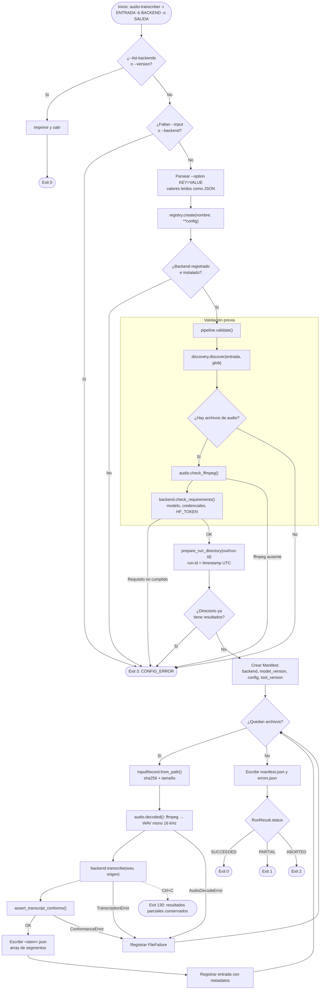
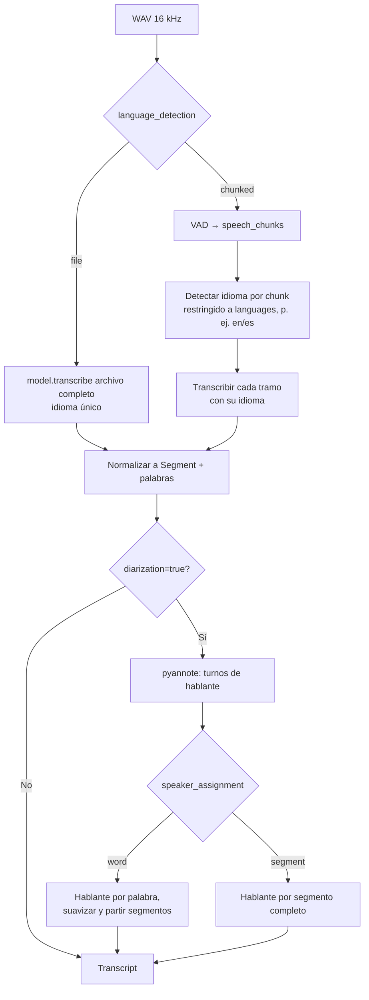
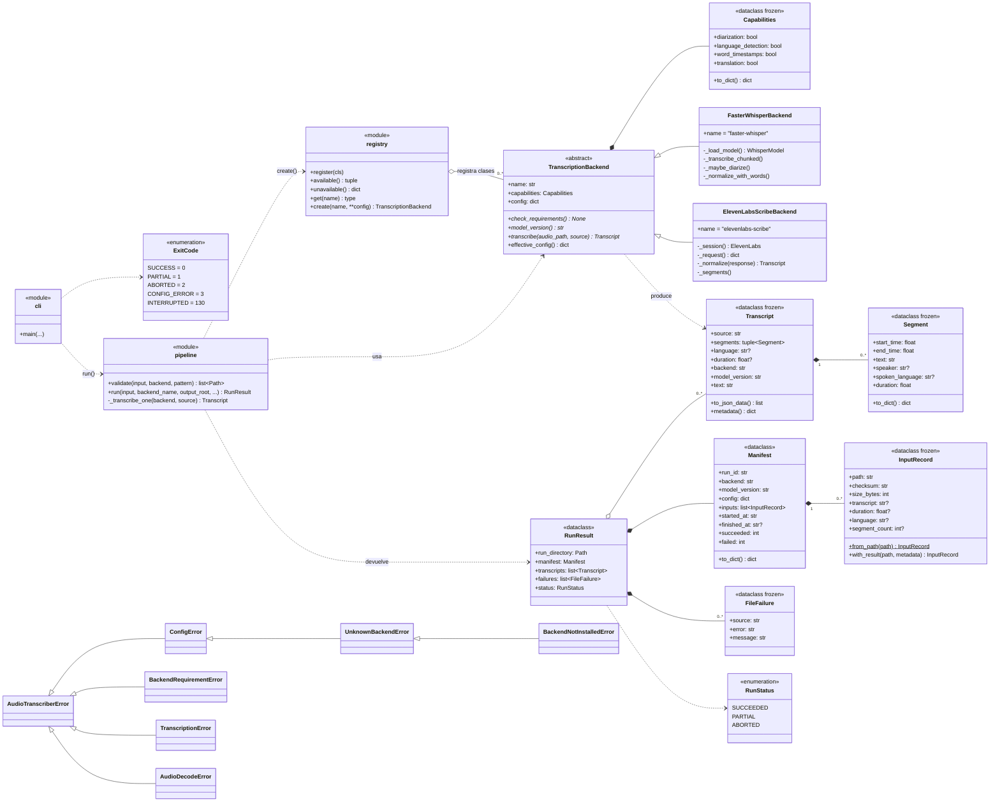
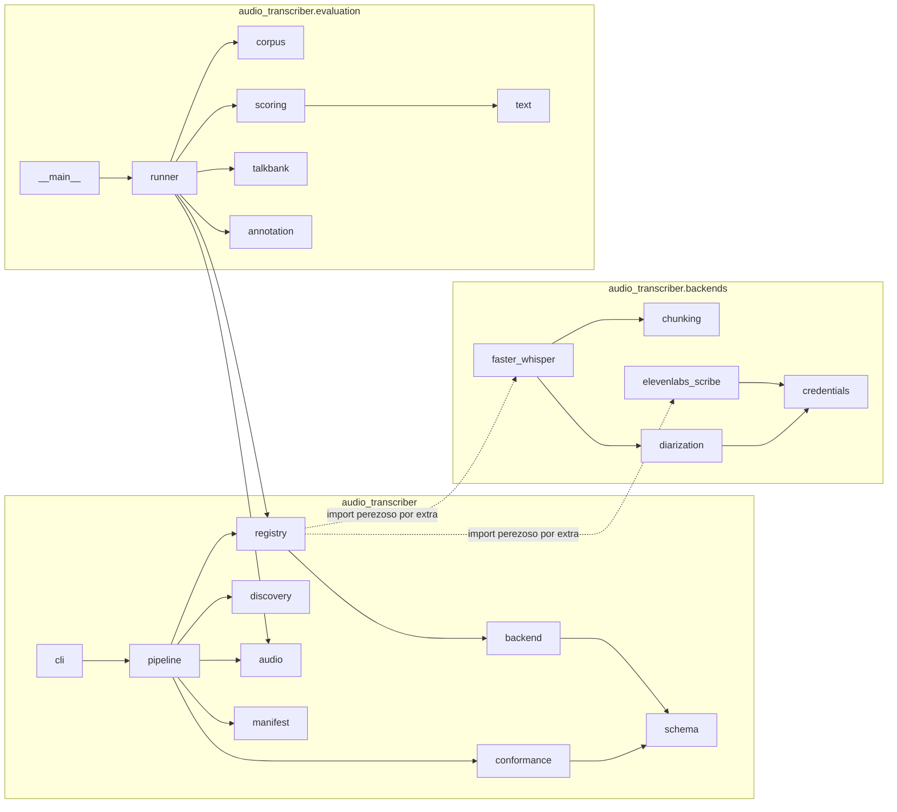
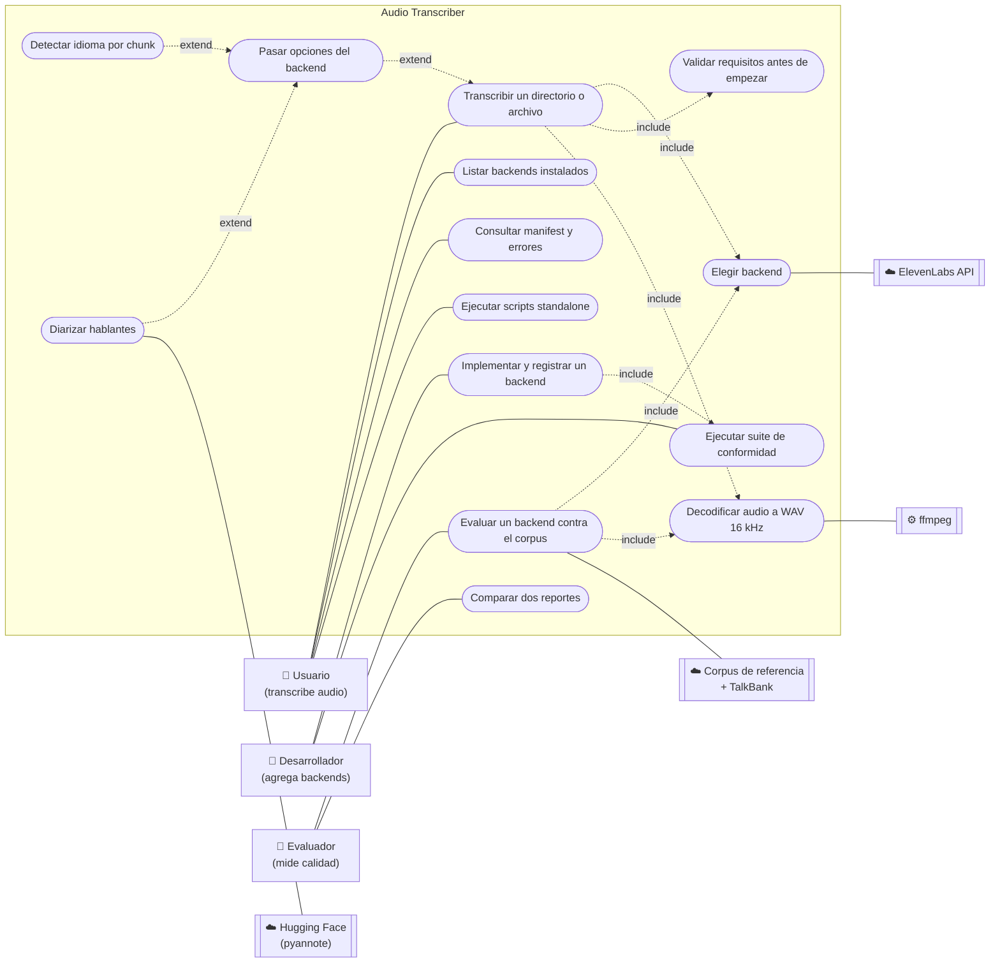
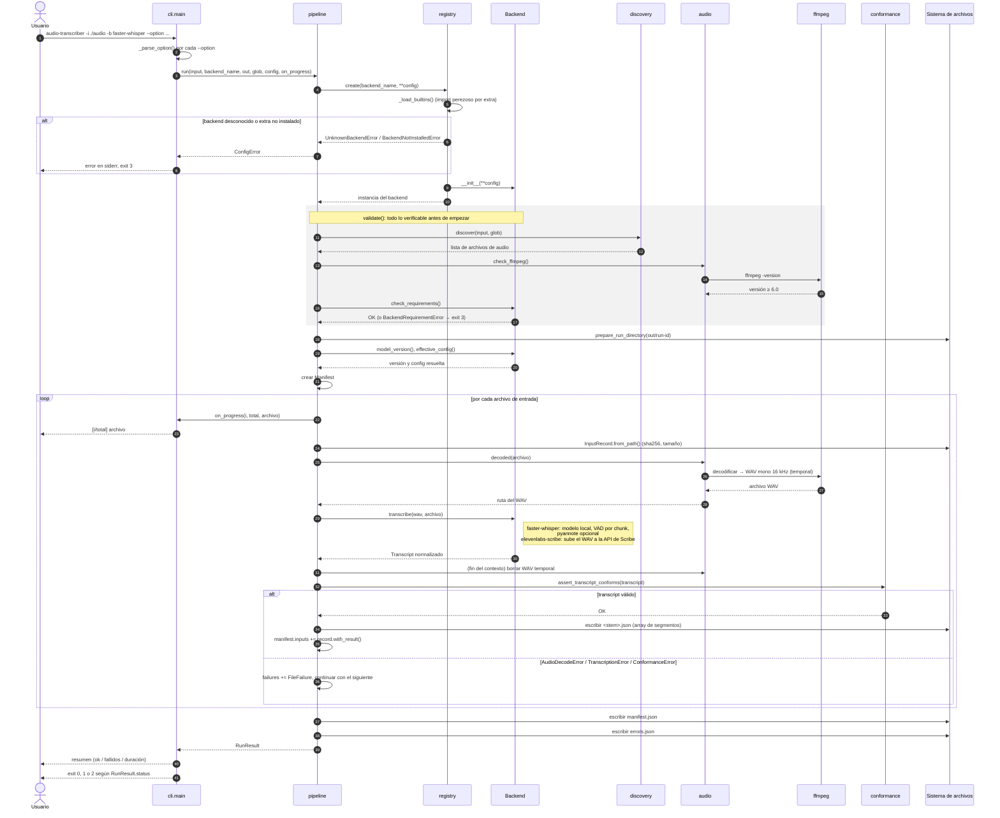

# Diagramas del repositorio

Cinco vistas de Audio Transcriber: el flujo de una ejecución, el modelo de clases (UML), los casos
de uso, la secuencia de llamadas y la evaluación contra el ground truth. Los diagramas están en Mermaid, que GitHub y la mayoría de editores renderizan directamente.

## 1. Diagrama de flujo — una ejecución de `audio-transcriber`

Recorre `cli.main` → `pipeline.run` → `pipeline._transcribe_one`. Un fallo por archivo nunca
aborta el lote; un fallo de configuración aborta antes de escribir nada.

### Dentro de `FasterWhisperBackend.transcribe`

## 2. Diagrama UML de clases

### Paquetes y dependencias

## 3. Diagrama de casos de uso

Mermaid no tiene un tipo de diagrama de casos de uso; se representa con actores (rectángulos) y
casos de uso (óvalos) dentro del límite del sistema.

| Actor | Casos de uso | Punto de entrada |
| ----- | ------------ | ---------------- |
| Usuario | Transcribir, listar backends, revisar resultados, scripts standalone | `python -m audio_transcriber`, `standalone/*.py` |
| Desarrollador | Implementar un `TranscriptionBackend`, pasar la conformidad | `registry.register`, `pytest -k conformance` |
| Evaluador | Medir WER/retención/mezcla de idiomas, comparar configuraciones | `python -m audio_transcriber.evaluation` |

## 4. Diagrama de secuencia — transcribir un lote

Las llamadas entre módulos durante `audio-transcriber -i ./audio -b faster-whisper`. El backend
es intercambiable; las notas indican qué hace cada uno dentro de `transcribe`.

## 5. Diagrama de flujo — evaluación contra el ground truth

El harness de `python -m audio_transcriber.evaluation` transcribe el corpus Bangor Miami
(subconjunto `mixed`: cinco grabaciones en inglés/español, unas 2.5 h) y compara cada hipótesis
con su transcripción de referencia. Con `--talkbank` también puntúa hablantes e idioma por
segmento contra las anotaciones originales de TalkBank. Detalle de las métricas en
[`evaluation.md`](evaluation.md).

```mermaid
flowchart TD
    A(["python -m audio_transcriber.evaluation"]) --> B{"¿--compare BASE CANDIDATO?"}

    %% ── Evaluar una configuración ──
    B -- No --> C{"¿--backend y --label?"}
    C -- No --> Z2(["Error de argumentos, exit 2"])
    C -- Sí --> D["registry.create(backend, **options)"]
    D --> E["audio.check_ffmpeg() + backend.check_requirements()"]
    E -- Falla --> Z3(["AudioTranscriberError, exit 3"])
    E -- OK --> F{"¿mixed.parquet en caché<br/>y válido? (≥100 MB, magic PAR1)"}
    F -- No --> F1["Descargar de Hugging Face"]
    F1 --> F2{"¿Parquet válido?"}
    F2 -- No --> Z3
    F2 -- Sí --> G
    F -- Sí --> G["corpus.load(): Recording por grabación<br/>audio MP3 + transcript de referencia + spanish_share"]
    G --> H["Filtrar con --only, si se dio"]
    H --> I{"¿--talkbank?"}
    I -- Sí --> I1["talkbank.load() por grabación:<br/>enunciados con hablante, tiempos e idioma"]
    I1 -- Archivo ausente --> Z3
    I1 --> J
    I -- No --> J["Crear Report: label, backend, model_version, config"]

    J --> K{"¿Quedan grabaciones?"}
    K -- Sí --> L["audio.decoded(): MP3 → WAV mono 16 kHz"]
    L --> M["backend.transcribe(wav)"]
    L -- Excepción --> M1["result.error = tipo: mensaje"]
    M -- Excepción --> M1
    M1 --> K

    M --> N["Hipótesis: normalize(transcript.text)<br/>minúsculas, sin puntuación ni acentos"]

    subgraph GT ["Ground truth"]
        G1["Referencia con marcado CHAT"] --> G2["clean_reference():<br/>quitar pausas, retracing, continuaciones,<br/>códigos de evento e inline, completar palabras parciales"]
        G2 --> G3["normalize()"]
    end
    G -.-> G1

    N --> S["scoring.score(referencia, hipótesis)"]
    G3 --> S
    S --> S1["jiwer: WER = (S + D + I) / palabras de referencia<br/>retained = (aciertos + sustituciones) / referencia<br/>coverage = palabras hipótesis / referencia<br/>language_mix_error = abs(diferencia de proporción de español)"]

    S1 --> T{"¿Hay referencia TalkBank?"}
    T -- Sí --> T1["language_confusion(): idioma por segmento vs. enunciado,<br/>por tiempo → accuracy, recall por idioma"]
    T1 --> T2{"¿El transcript tiene hablantes<br/>y la referencia es diarizable?"}
    T2 -- Sí --> T3["diarization_error(): DER = missed + false alarm + confusion"]
    T2 -- No --> T4["diarization = null o diarization_skipped"]
    T3 --> U
    T4 --> U
    T -- No --> U["Agregar RecordingResult al Report<br/>segmentos, idiomas detectados, realtime factor"]
    U --> V["Escribir eval/transcripts/grabación.label.txt y .json"]
    V --> K

    K -- No --> W["report.write(eval/label.json)<br/>resumen: medias de WER, retained, coverage, mezcla de idioma"]
    W --> Z0(["Imprimir resumen, exit 0"])

    %% ── Comparar dos reportes ──
    B -- Sí --> X["Cargar ambos reportes"]
    X --> Y{"Por cada grabación puntuada en los dos"}
    Y --> Y1{"¿WER candidato < WER base<br/>y retained candidato ≥ retained base − 0.02?"}
    Y1 -- Sí --> Y2["improved = true"]
    Y1 -- No --> Y3["improved = false<br/>(una mejora de WER perdiendo contenido no cuenta)"]
    Y2 --> Y4["Deltas por grabación y de las medias<br/>WER, retained, coverage, mezcla de idioma, TalkBank"]
    Y3 --> Y4
    Y4 --> Y5{"¿Mejoró en todas las grabaciones?"}
    Y5 -- Sí --> ZC0(["JSON de comparación, exit 0"])
    Y5 -- No --> ZC1(["JSON de comparación, exit 1"])
```

